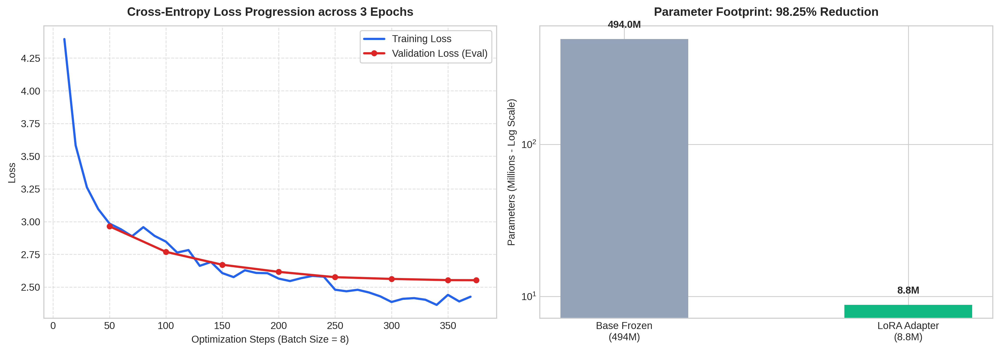

# Qwen2.5-0.5B LoRA: Hinglish Poetry (baseline)

A first LoRA fine-tune of `Qwen/Qwen2.5-0.5B-Instruct` on Roman Urdu poetry. The goal was to learn the full fine-tuning pipeline end to end. The output is still rough, and this is documented as a baseline, not a finished model.

## Before and after

- **Base model:** asked for a Hinglish poem, it said it didn't know the style.
- **Tuned model:** produces Hinglish verse. Lines are often ungrammatical and drift off topic.

## Model

| | |
|---|---|
| Base model | `Qwen/Qwen2.5-0.5B-Instruct` (494M parameters) |
| Method | LoRA (PEFT), rank 16, alpha 32, dropout 0.05 |
| Target modules | `q_proj`, `k_proj`, `v_proj`, `o_proj`, `gate_proj`, `up_proj`, `down_proj` |
| Trainable parameters | 8.8M (1.75% of total) |
| Precision | fp16 |

## Data

- Source: [`keplersystems/UrduPoetry-35k`](https://huggingface.co/datasets/keplersystems/UrduPoetry-35k)
- Used the first 1,100 rows, split into 1,000 train / 100 eval (seed 42).
- Preprocessing: replaced "Roman Urdu" with "Hinglish" and "ghazal" with "poem" in the prompts, and "sher" with "verse".
- Token length (train): min 52, median 230, 95th percentile 393, max 844. `max_length` is 384.

## Training

| Setting | Value |
|---|---|
| Epochs | 3 (375 steps) |
| Batch size | 2 per device × 4 gradient accumulation = 8 effective |
| Learning rate | 2e-4, cosine schedule |
| Warmup | 19 steps (~5%) |
| Eval | every 50 steps |
| Hardware | Google Colab, NVIDIA T4 |
| Runtime | ~702 s (~12 min) |

### Results

| Metric | Value |
|---|---|
| Eval loss at step 50 | 2.96 |
| Eval loss at step 375 | 2.55 |
| Final training loss (average) | 2.70 |

Eval loss kept falling until the end of training, so the model is probably undertrained. Output quality is limited by the small training set.



## Known limitations

- Grammar breaks down within a few lines, and poems often lose the theme.
- Roman Urdu has many spellings for the same word, which makes learning harder.
- Only 1,000 examples and 3 epochs. The dataset has 35k rows.
- Evaluation is informal: a few prompts, judged by eye. No automatic quality metric.
- The prompt rewrite (Roman Urdu → Hinglish) means the model learns that "Hinglish" refers to Roman Urdu verse.

## Reproduce

1. Open `qwen_hinglish_finetune.ipynb` in Colab with a GPU runtime (T4 is enough).
2. Run the install cell (uncomment it on first run).
3. Run all cells in order. Training takes about 12 minutes.
4. The adapter is saved to `qwen_hinglish_poetry_adapter/`. This folder is not committed; see `.gitignore`.

To load the adapter later:

```python
from peft import PeftModel
from transformers import AutoModelForCausalLM

base = AutoModelForCausalLM.from_pretrained("Qwen/Qwen2.5-0.5B-Instruct", dtype=torch.float16, device_map="auto")
model = PeftModel.from_pretrained(base, "qwen_hinglish_poetry_adapter")
```

## Environment

- trl: `<fill in>`
- transformers: `<fill in>`
- peft: `<fill in>`

Run `import trl, transformers, peft; print(trl.__version__, transformers.__version__, peft.__version__)` to get these.

## Next steps

- Clean the dataset: normalize spellings, remove duplicates, drop very long rows.
- Train on more examples (5k to 10k) and compare eval loss.
- Build a fixed set of ~20 eval prompts and score base vs. tuned outputs.
- Try `Qwen/Qwen2.5-1.5B-Instruct` with the same LoRA config.